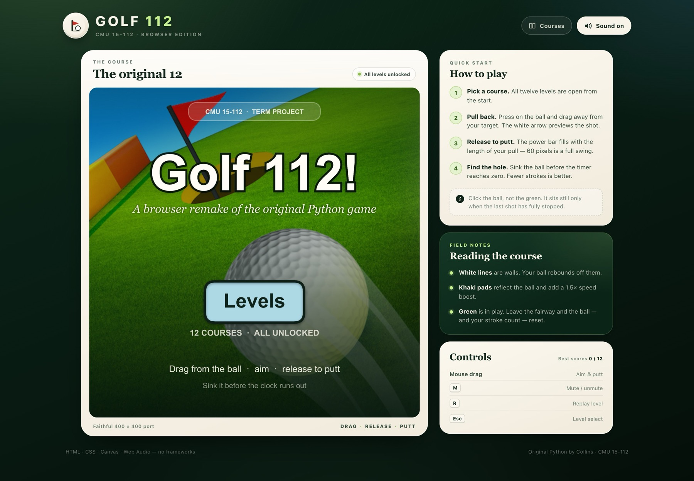
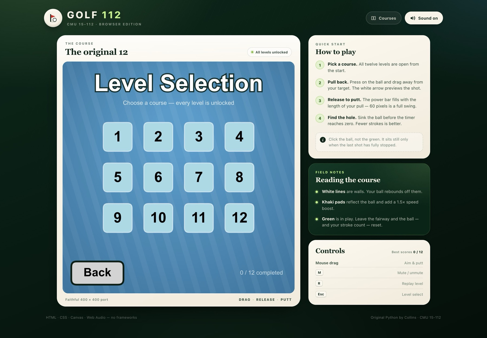
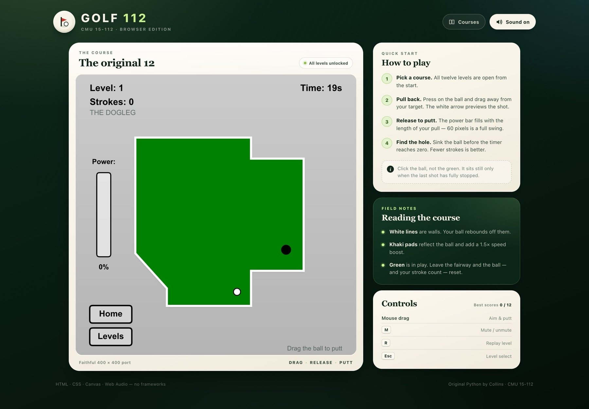
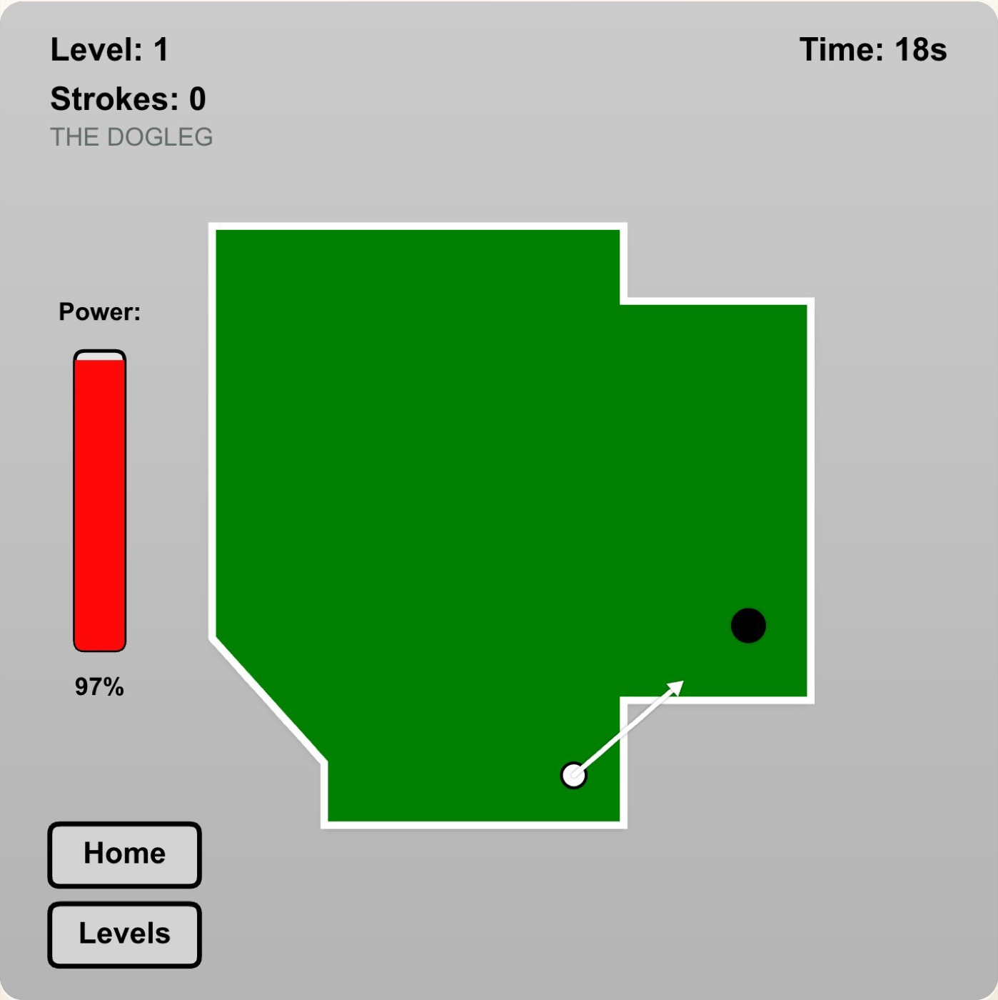
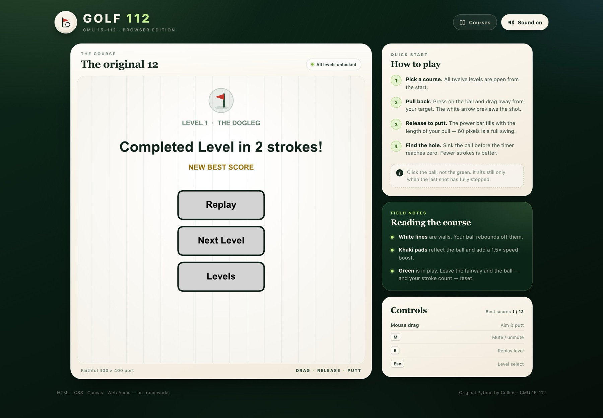

# Golf 112 — Browser Edition

A faithful, zero-install browser remake of my CMU 15-112 Python term project: a
12-course slingshot golf game originally written with `cmu_graphics`.

The original Python source is preserved untouched in [`src/main.py`](src/main.py).
The playable website lives in [`web/`](web/).

[](docs/screenshots/desktop-start.jpg)

## Play it

The site is a static application — no build step, no framework, no install.

```bash
# from the repository root
python3 -m http.server 8000 --directory web
```

Open **http://localhost:8000**.

> Opening `index.html` directly with `file://` will load the game, but browsers
> block `fetch()` for the audio files. Use a local server (or GitHub Pages).

### Controls

| Input | Action |
| --- | --- |
| Mouse / trackpad drag from the ball | Pull back and aim; release to putt |
| **M** | Mute / unmute |
| **R** | Replay the current level |
| **Esc** | Return to the level select |

The white arrow previews the shot, the power bar fills with the length of the
pull (60 px = 100%), and the timer runs from the moment the course loads.

## What is preserved

- **All 12 original courses.** Every polygon point, wall segment, ball start,
  hole position, bounce pad, and time limit is copied 1:1 from `src/main.py`.
- **The original physics.** 50 physics substeps per 30 Hz frame, five collision
  passes per substep, axis-flip wall rebounds, 0.96 per-step friction, the
  `< 0.05` resting threshold, the 60 px drag limit, `power = 0.1`, and the
  7 px hole / 5 px ball geometry.
- **Scoring and rules.** Strokes count only real putts. Leaving the fairway
  resets the ball and the stroke count, exactly as before. Sinking the ball
  wins; the clock running out fails the level.
- **The original screen flow.** Start → level select → game → win/fail, with
  white fades between the game and result screens.
- **The original controls and HUD.** Drag-to-putt, power bar, level/stroke/time
  labels, Home/Levels buttons, replay/next/levels result buttons.
- **All five audio assets.** Looping BGM, golf hit, wall hit, win, and fail.
- **All levels unlocked**, matching `unlockedLevels = 12` in the original.

## Screenshots

| Level select | Gameplay |
| --- | --- |
|  |  |

| Aiming | Win screen |
| --- | --- |
|  |  |

More course screenshots: [Bullseye (level 6)](docs/screenshots/level-6-bullseye.jpg)
and [The Gauntlet (level 12)](docs/screenshots/level-12-gauntlet.jpg).

## Conversion strategy

`cmu_graphics` is a Tkinter desktop framework. It owns a native window, a
30 steps/second event loop, image/audio paths relative to the Python process,
and Tk's canvas — none of which map cleanly onto a browser. Running the original
through Pyodide would still require a Tk-backed display and would leave the
audio and window lifecycle awkward. A direct Canvas port is smaller, faster,
and genuinely deployable as a static site.

The result is vanilla HTML, CSS, and JavaScript:

| File | Responsibility |
| --- | --- |
| [`web/js/levels.js`](web/js/levels.js) | Level data ported 1:1 from `app.levelData` |
| [`web/js/game.js`](web/js/game.js) | State machine, input, physics, collisions, scoring, Canvas rendering |
| [`web/js/audio.js`](web/js/audio.js) | Streaming BGM + Web Audio effects |
| [`web/index.html`](web/index.html) | Semantic page shell and instructions |
| [`web/css/style.css`](web/css/style.css) | Responsive clubhouse-style presentation |
| [`web/assets/`](web/assets) | Exact copies of the six original assets |

### Key decisions

- **Fixed 30 Hz physics, 60 fps rendering.** `requestAnimationFrame` feeds an
  accumulator; physics steps only when a full 1/30 s frame is due. Rendering can
  run at the display's refresh rate without changing the game's feel.
- **A 400 × 400 logical world.** The original coordinate system is untouched.
  The canvas backing store is sized from its CSS box and `devicePixelRatio`, so
  the game is crisp at any desktop size.
- **Exact collision port.** The browser reproduces the original's five-pass
  distance-to-segment collision resolution, including its axis-flip reflection
  rule and its bounce-pad reflection with the 1.5× speed boost. These were
  cross-checked against a line-by-line Python reference (see below).
- **Even-odd polygon fill.** Canvas defaults to nonzero winding. Level 9's
  course polygon self-intersects, so the map uses `fill('evenodd')` to match the
  odd-even fill used by current Tk versions.
- **Audio that respects autoplay policy.** The BGM is an `<audio>` element
  started by the first user gesture. Effects are decoded into Web Audio buffers
  for low-latency, overlapping playback. Wall-hit sounds are throttled to 55 ms
  and mixed lower than the original to avoid the machine-gun stacking that
  multiple wall contacts per frame can cause.
- **Result screens and timers.** Win/fail fades advance 5 opacity units per
  physics step, exactly as in the original. The timer is driven by real elapsed
  time, not a countdown that pauses when the ball is still.

### Deliberate differences from the Python version

These are the only known behavioral additions/fixes; the game rules are
otherwise unchanged.

1. **BGM waits for the first gesture** (browser autoplay requirement). Python
   started it on launch.
2. **Effects are mixed/throttled** for browser audio (see above).
3. **Best scores are stored in `localStorage`.** The original did not track
   records. Completed courses get a check badge and strokes are shown on the win
   screen; all levels remain unlocked.
4. **The ball trail is cleared when a new course loads.** The original
   `resetBall()` left the previous course's trail visible.
5. **A win on the same frame as the timer expiring counts as a win.** The
   original could set both `win` and `fail` on that frame.
6. **“Next Level” is visibly disabled on level 12.** The original rendered a
   live-looking button that silently did nothing.
7. **Home/Levels/Back hitboxes match their drawings**, and the interface has
   level names, keyboard shortcuts, a responsive shell, and high-DPI rendering.

## Verification

Full details and the manual-test checklist are in
[`docs/VERIFICATION.md`](docs/VERIFICATION.md).

```bash
cd tests
npm install
npm test
```

Chrome is used automatically when installed. On a machine without Chrome, run
`npx playwright install chromium` once first. Node 18+ is required.

The suite starts its own static server under `/golf-112/` (the same shape as a
GitHub Pages project site) and drives the real game in Chrome.

**Result: 12/12 checks passed, repeated three consecutive times.** The suite
verifies:

- boot, start screen, layout, canvas role/label, and no console errors;
- start → levels → game → home/levels/escape navigation;
- real-time clock, drag aiming, stroke counting, launch direction, trail;
- **a complete two-putt victory on level 1 using only mouse input** (no
  teleporting or injected state), including the win fade and score;
- wall collisions, bounce-pad reflection/boost, friction and stopping,
  out-of-bounds reset, and inner-wall collisions **with numeric parity against
  a Python reference**;
- hole detection, win flow, score recording, next-level behavior, level-12
  guard, timer expiry, fail flow, and retry;
- BGM start after a gesture, all four effects decoded, sound-trigger counters,
  mute persistence, and best-score persistence;
- all 12 levels load with the expected ball, hole, and time limit;
- the production build works without the opt-in debug API;
- a 390 × 844 responsive layout with no horizontal overflow.

Tested on **Google Chrome 156 / macOS 27.0.1**. The implementation uses standard
Canvas, Pointer Events, Web Audio, and CSS. Safari/WebKit and Firefox were not
part of the automated run in this environment; see the
[verification report](docs/VERIFICATION.md) for the manual checklist.

### What still needs human ears / hardware

- Listening to the BGM loop and each effect at a comfortable volume.
- Playing with a physical touchscreen (the layout is responsive, but the
  original 5 px ball hit target is intentionally preserved and is small).
- A side-by-side subjective playthrough against the original Python build or
  the [demo video](https://youtu.be/7o2HCYIfmC8) for feel/timing.

## Deploy to GitHub Pages

The workflow at [`.github/workflows/deploy-pages.yml`](.github/workflows/deploy-pages.yml)
publishes the `web/` folder automatically on every push to `main`.

### One-time setup

1. Create a new **public** repository on GitHub. Do not add a README or
   `.gitignore` (this repository already has them).
2. From this project directory:

   ```bash
   git init
   git add .
   git commit -m "Add Golf 112 browser edition"
   git branch -M main
   git remote add origin https://github.com/<your-username>/<your-repo>.git
   git push -u origin main
   ```

3. In the repository, open **Settings → Pages** and set
   **Build and deployment → Source** to **GitHub Actions**. (The workflow asks
   Pages to enable itself, but this setting is the reliable manual fallback.)
4. Open the **Actions** tab and watch “Deploy Golf 112 to GitHub Pages” finish.
5. The public URL will be:

   ```text
   https://<your-username>.github.io/<your-repo>/
   ```

   If the repository is named `<your-username>.github.io`, the URL is
   `https://<your-username>.github.io/`.

With the GitHub CLI, after `git init`, `git add .`, and the initial commit,
steps 1–3 can be shortened to:

```bash
gh repo create <your-repo> --public --source=. --remote=origin --push
gh api -X PUT repos/<your-username>/<your-repo>/pages -f build_type=workflow
```

> **Publication status:** no public URL has been created yet. This workspace had
> no GitHub authentication (`gh` is not installed), so a repository could not be
> created or pushed from here. Everything needed for the one-command deploy is
> in place; the steps above take a few minutes.

## Original Python project

The course project is still here:

- [`src/main.py`](src/main.py) — 870-line `cmu_graphics` implementation.
- [`src/BGM.mp3`](src/BGM.mp3), `Fail.mp3`, `GolfHit.mp3`, `WallHit.mp3`,
  `WinSound.mp3`, and `Picture.jpg` — original assets.
- `112 demo (1).mp4` and `Video-demo.txt` — original demo recording and link.

To run the original (requires Python with Tk and the course library):

```bash
python3 -m pip install cmu_graphics
cd src
python3 main.py
```

The original collision routine carries a citation to ChatGPT in the source
comments; the browser port reimplements the same algorithm.

## Project layout

```text
.
├── .github/workflows/deploy-pages.yml   # GitHub Pages deployment
├── docs/                                # screenshots + verification report
├── src/                                 # ORIGINAL PYTHON — never modified
├── tests/                               # Playwright end-to-end suite
│   ├── e2e.mjs
│   └── package.json
├── web/                                 # deployable static site
│   ├── assets/                          # reused game assets
│   ├── css/style.css
│   ├── js/{levels,audio,game}.js
│   ├── index.html
│   └── .nojekyll
├── README.md
└── ...original course files
```

## Assets and licensing

The six assets in `web/assets/` are byte-for-byte copies of the originals in
`src/`. Their SHA-256 hashes match (for example, `BGM.mp3` is
`97ae25893b8e4f103b97d21263a4cc384cdd52b8f8992bcf58c80371f4025c8f`).

The original repository documents no license or attribution for the image and
audio. Reuse them here only if you have the rights to do so. If this is published
as a public portfolio piece, confirm the image/audio provenance or replace them
with assets you own; the game code and layouts are the student project itself.

The browser version uses no third-party runtime libraries. Playwright is a
development-only dependency for the test suite.

## Credits

- Original game, levels, physics, and assets: Collins — CMU 15-112 term project.
- Browser port: direct Canvas/Web Audio reimplementation of `src/main.py`.
- Course: [Carnegie Mellon 15-112](https://www.cs.cmu.edu/~112/).
